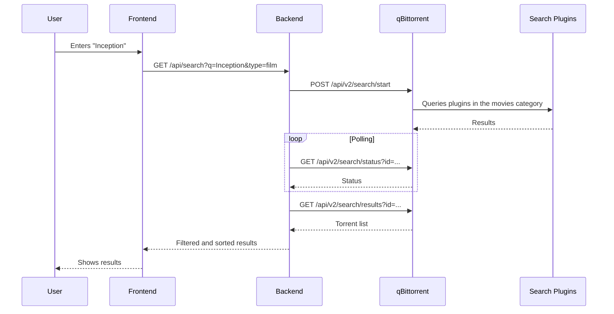
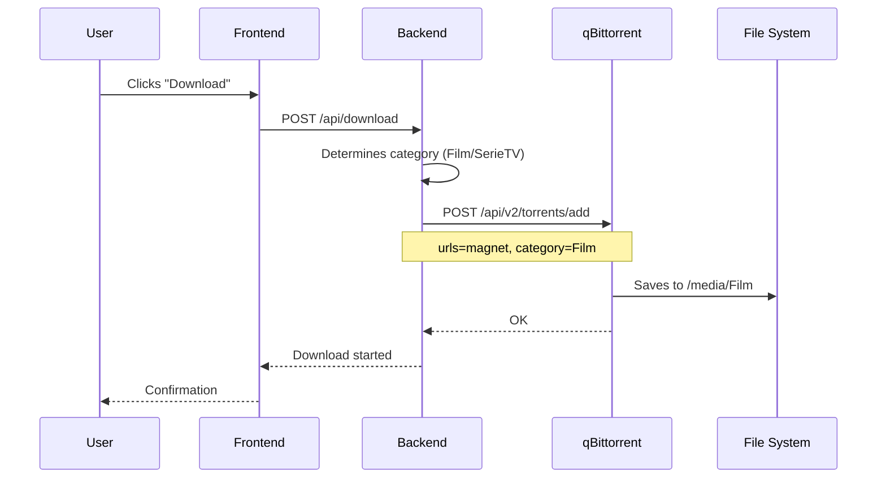

# Architecture – Self-Service Portal for Films and TV Series on qBittorrent

## 1. Context

Build a custom, simple and secure frontend that lets a non-technical user (e.g. your wife) do the following:

- search for films and TV series;
- select a result;
- start the download on qBittorrent;
- automatically save the content in predefined, separate folders.

The frontend relies on qBittorrent and its **search plugins** through the official Web API. The user must never see qBittorrent, the save paths or the credentials.

---

## 2. Goals and non-goals

### Goals

- Minimal web interface for searching and downloading films and TV series.
- Automatic mapping between content type and destination folder.
- No manual path configuration by the end user.
- Use of the search plugins already installed in qBittorrent.
- Simple monitoring of download status.
- Isolation of the qBittorrent credentials from the browser.

### Non-goals

- Replacing Sonarr/Radarr or other library managers.
- Handling music, books, games or software.
- Exposing the qBittorrent WebUI directly to the Internet.
- Allowing the end user to change qBittorrent categories, paths or settings.

---

## 3. Requirements

### Functional

| ID | Requirement |
|----|-----------|
| F1 | The user can search for films and TV series by keyword. |
| F2 | Results show name, size, seeders, leechers and source. |
| F3 | The user can start the download of a result. |
| F4 | The download is automatically assigned to the `Film` or `SerieTV` category. |
| F5 | Each category saves to a predefined path. |
| F6 | The user can see in-progress and completed downloads. |
| F7 | The user can cancel a download. |
| F8 | Access is protected by login. |

### Non-functional

| ID | Requirement |
|----|-----------|
| NF1 | Responsive interface, usable from a smartphone. |
| NF2 | Perceived response time < 2 s for search. |
| NF3 | qBittorrent credentials never exposed to the frontend. |
| NF4 | Communication with qBittorrent only from the internal network or containers. |
| NF5 | Configuration through environment variables. |
| NF6 | Essential logs for debugging and audit. |

---

## 4. Overall architecture


### Main components

| Component | Role |
|------------|-------|
| Frontend | User interface: search, results, downloads, status. |
| Backend | Authentication, proxy to qBittorrent, category logic. |
| qBittorrent | Download engine and host of the search plugins. |
| Search Plugins | Search plugins installed in qBittorrent. |
| File System | Final folders for Films and TV Series. |
| Reverse Proxy | HTTPS, secure external access. |
| TMDB (optional) | Metadata, cover images, normalized titles. |

---

## 5. Main flows

### 5.1 Search



### 5.2 Download



### 5.3 Monitoring


---

## 6. Categories and paths

Two categories with fixed paths are created in qBittorrent.

| Category | Save path | Content |
|-----------|------------------------|-----------|
| `Film` | `/media/Film` | Films |
| `SerieTV` | `/media/SerieTV` | TV Series |

### Rules

- Create the categories via API or manually in the WebUI.
- Disable the **"Append category name to save path"** option.
- The backend does not accept paths from the frontend: the category is the only parameter.
- The paths must be mounted volumes writable by the qBittorrent container.

### Creating categories via API

```http
POST /api/v2/torrents/createCategory
Content-Type: application/x-www-form-urlencoded

category=Film&savePath=/media/Film
```

```http
POST /api/v2/torrents/createCategory
Content-Type: application/x-www-form-urlencoded

category=SerieTV&savePath=/media/SerieTV
```

---

## 7. Proposed backend API

| Method | Endpoint | Description |
|--------|----------|-------------|
| POST | `/api/login` | Application user login. |
| GET | `/api/search` | Starts a search and retrieves results. |
| POST | `/api/download` | Adds a torrent to qBittorrent. |
| GET | `/api/torrents` | Lists Film/SerieTV downloads. |
| DELETE | `/api/torrents/{hash}` | Cancels or removes a torrent. |
| GET | `/api/health` | Service status. |

### Example download request

```json
POST /api/download
{
  "magnet": "magnet:?xt=urn:btih:...",
  "type": "film"
}
```

The backend translates `type` into a category:

- `film` → `Film`
- `serie` → `SerieTV`

---

## 8. qBittorrent integration

### Authentication

The backend logs in and keeps the session cookie.

```http
POST /api/v2/auth/login
Content-Type: application/x-www-form-urlencoded

username=admin&password=***
```

### Main endpoints used

| Function | Endpoint |
|----------|----------|
| Login | `POST /api/v2/auth/login` |
| Search start | `POST /api/v2/search/start` |
| Search status | `GET /api/v2/search/status` |
| Search results | `GET /api/v2/search/results` |
| Available plugins | `GET /api/v2/search/plugins` |
| Add torrent | `POST /api/v2/torrents/add` |
| List torrents | `GET /api/v2/torrents/info` |
| Create category | `POST /api/v2/torrents/createCategory` |
| List categories | `GET /api/v2/torrents/categories` |
| WebAPI version | `GET /api/v2/app/webapiVersion` |

### Version notes

- `category` in `torrents/add` is supported by recent versions.
- A category-level `savePath` is the recommended solution.
- Check that the WebAPI is ≥ 2.1.0 for the advanced features.

---

## 9. Search through qBittorrent plugins

The backend uses qBittorrent's Search API.

Typical `search/start` parameters:

- `pattern`: the searched text
- `plugins`: list of plugins separated by `|`
- `category`: `movies` or `tv`

The backend filters the plugins according to the requested type:

| User type | Plugin category |
|-------------|------------------|
| Film | `movies` |
| TV Series | `tv` |

Results are normalized and sorted by descending seeders.

---

## 10. Security

- Application login separate from qBittorrent.
- qBittorrent credentials only in the backend, never in the browser.
- HTTPS mandatory if reachable from outside the home.
- Rate limiting on the search and download endpoints.
- Strict validation of the `type` parameter: only `film` or `serie`.
- No file paths entered by the user.
- Logs without credentials.
- qBittorrent not directly exposed to the Internet.

---

## 11. Suggested deployment

```yaml
version: "3.8"

services:
  frontend:
    build: ./frontend
    ports:
      - "8080:80"
    depends_on:
      - backend

  backend:
    build: ./backend
    environment:
      QBITTORRENT_URL: http://qbittorrent:8080
      QBITTORRENT_USER: admin
      QBITTORRENT_PASS: ${QB_PASS}
      CATEGORY_FILM: Film
      CATEGORY_TV: SerieTV
      APP_USER: wife
      APP_PASS: ${APP_PASS}
      SECRET_KEY: ${SECRET_KEY}
    depends_on:
      - qbittorrent

  qbittorrent:
    image: lscr.io/linuxserver/qbittorrent:latest
    volumes:
      - /media/Film:/media/Film
      - /media/SerieTV:/media/SerieTV
      - ./qbittorrent/config:/config
    environment:
      - WEBUI_PORT=8080
```

---

## 12. Configuration

Backend environment variables:

| Variable | Description |
|-----------|-------------|
| `QBITTORRENT_URL` | qBittorrent WebUI URL |
| `QBITTORRENT_USER` | qBittorrent user |
| `QBITTORRENT_PASS` | qBittorrent password |
| `CATEGORY_FILM` | Film category name, default `Film` |
| `CATEGORY_TV` | Series category name, default `SerieTV` |
| `APP_USER` | Portal user |
| `APP_PASS` | Portal password |
| `SECRET_KEY` | Session key |

---

## 13. Error handling

| Code | Cause | Action |
|--------|-------|--------|
| 401 | Wrong qBittorrent credentials | Log, generic message |
| 403 | User not authenticated | Redirect to login |
| 409 | Invalid category path | Check volumes |
| 415 | Invalid torrent | Message to the user |
| 502 | qBittorrent unreachable | Retry and message |
| 504 | Search timeout | Reduce plugins or timeout |

---

## 14. Future extensions

- TMDB integration for cover images and normalized titles.
- Automatic search for season/episode for series.
- Push notifications on completion.
- Support for multiple users with separate categories.
- Integration with Jellyfin/Plex for the library.
- Quality filter (1080p, 4K) and language.
- Automatic subtitle download.

---

## 15. Glossary

| Term | Meaning |
|---------|-------------|
| Web API v2 | qBittorrent's HTTP API |
| Search Plugin | Search extension installed in qBittorrent |
| Category | Logical grouping that maps to a path |
| Magnet | Link for a BitTorrent download |
| Seeders | Peers that hold the complete file |

---

**Final note:** this architecture deliberately keeps the frontend simple. All the complexity of qBittorrent, categories and paths stays in the backend. The end user sees only a search box and a "Download" button.
