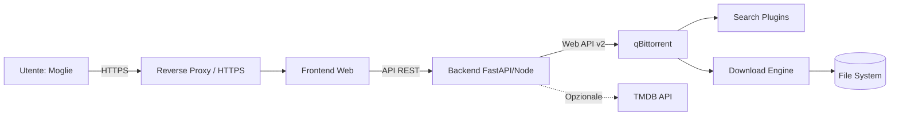
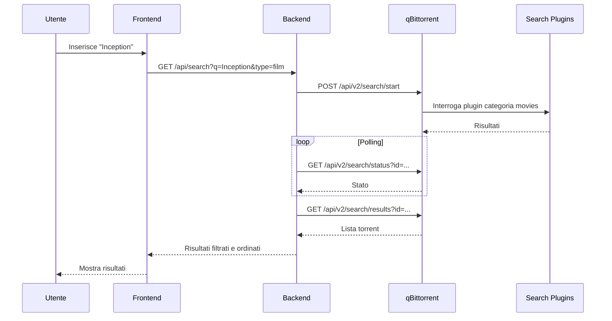
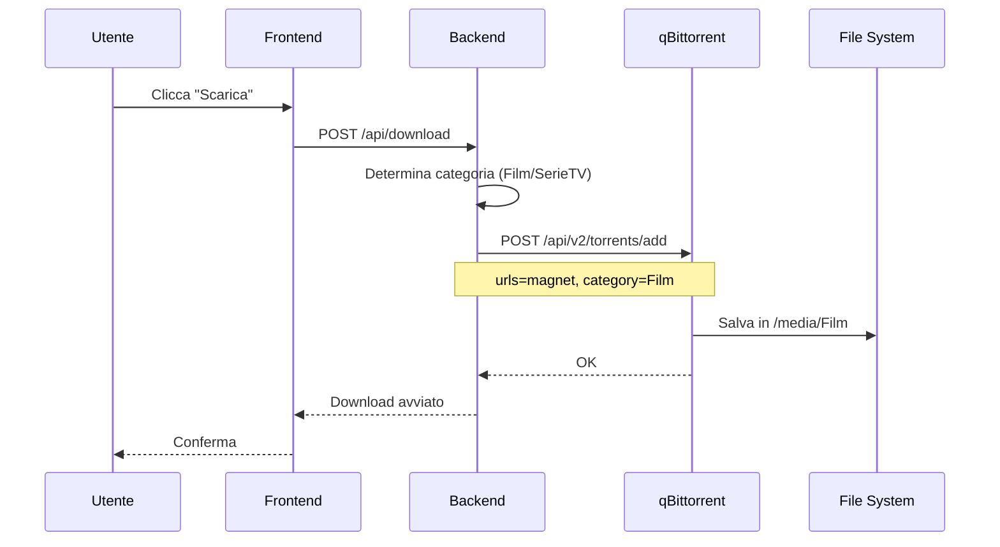
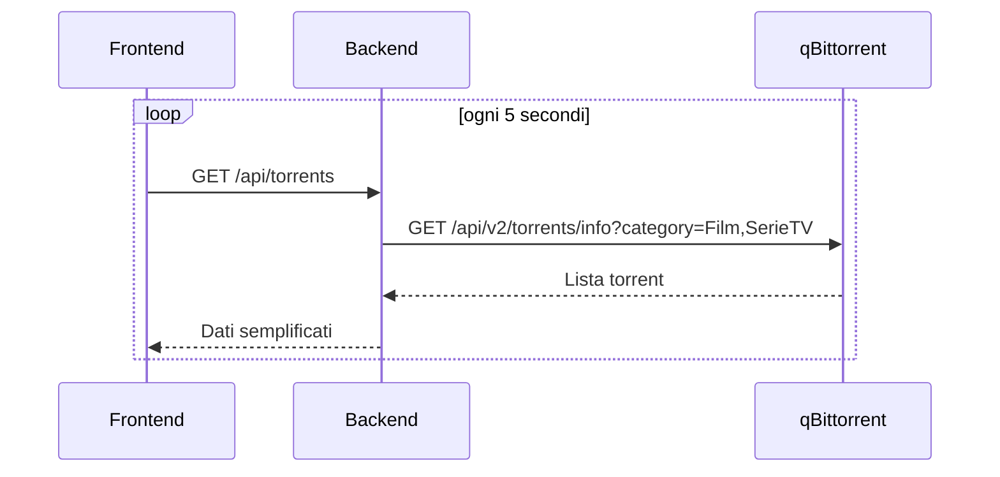

# Architettura – Portale Self-Service Film e Serie TV su qBittorrent

## 1. Contesto

Realizzare un frontend personalizzato, semplice e sicuro, che permetta a un utente non tecnico (es. tua moglie) di:

- cercare film e serie TV;
- selezionare un risultato;
- avviare il download su qBittorrent;
- salvare automaticamente il contenuto in cartelle predefinite e separate.

Il frontend si appoggia a qBittorrent e alle sue **estensioni di ricerca** (search plugins) tramite la Web API ufficiale. L’utente non deve mai vedere qBittorrent, i percorsi di salvataggio o le credenziali.

---

## 2. Obiettivi e non obiettivi

### Obiettivi

- Interfaccia web minimale per ricerca e download di film e serie TV.
- Associazione automatica tra tipo di contenuto e cartella di destinazione.
- Nessuna configurazione manuale del percorso da parte dell’utente finale.
- Utilizzo delle estensioni di ricerca già installate in qBittorrent.
- Monitoraggio semplice dello stato dei download.
- Isolamento delle credenziali di qBittorrent dal browser.

### Non obiettivi

- Sostituire Sonarr/Radarr o altri gestori di libreria.
- Gestire musica, libri, giochi o software.
- Esporre direttamente la WebUI di qBittorrent a Internet.
- Consentire all’utente finale di modificare categorie, percorsi o impostazioni di qBittorrent.

---

## 3. Requisiti

### Funzionali

| ID | Requisito |
|----|-----------|
| F1 | L’utente può cercare film e serie TV per parola chiave. |
| F2 | I risultati mostrano nome, dimensione, seeders, leechers e fonte. |
| F3 | L’utente può avviare il download di un risultato. |
| F4 | Il download viene associato automaticamente alla categoria `Film` o `SerieTV`. |
| F5 | Ogni categoria salva in un percorso predefinito. |
| F6 | L’utente può vedere i download in corso e completati. |
| F7 | L’utente può annullare un download. |
| F8 | L’accesso è protetto da login. |

### Non funzionali

| ID | Requisito |
|----|-----------|
| NF1 | Interfaccia responsive, utilizzabile da smartphone. |
| NF2 | Tempo di risposta percezione < 2 s per la ricerca. |
| NF3 | Credenziali qBittorrent mai esposte al frontend. |
| NF4 | Comunicazione con qBittorrent solo da rete interna o container. |
| NF5 | Configurazione tramite variabili d’ambiente. |
| NF6 | Log essenziali per debug e audit. |

---

## 4. Architettura generale



### Componenti principali

| Componente | Ruolo |
|------------|-------|
| Frontend | Interfaccia utente: ricerca, risultati, download, stato. |
| Backend | Autenticazione, proxy verso qBittorrent, logica categorie. |
| qBittorrent | Motore di download e host delle estensioni di ricerca. |
| Search Plugins | Plugin di ricerca installati in qBittorrent. |
| File System | Cartelle finali per Film e Serie TV. |
| Reverse Proxy | HTTPS, accesso esterno sicuro. |
| TMDB (opzionale) | Metadati, copertine, titoli normalizzati. |

---

## 5. Flussi principali

### 5.1 Ricerca



### 5.2 Download



### 5.3 Monitoraggio



---

## 6. Categorie e percorsi

In qBittorrent vengono create due categorie con percorsi fissi.

| Categoria | Percorso di salvataggio | Contenuto |
|-----------|------------------------|-----------|
| `Film` | `/media/Film` | Film |
| `SerieTV` | `/media/SerieTV` | Serie TV |

### Regole

- Creare le categorie via API o manualmente nella WebUI.
- Disabilitare l’opzione **“Append category name to save path”**.
- Il backend non accetta percorsi dal frontend: la categoria è l’unico parametro.
- I percorsi devono essere volumi montati e scrivibili dal container qBittorrent.

### Creazione categorie via API

```http
POST /api/v2/torrents/createCategory
Content-Type: application/x-www-form-urlencoded

category=Film&savePath=/media/Film
```

```http
POST /api/v2/torrents/createCategory
Content-Type: application/x-www-form-urlencoded

category=SerieTV&savePath=/media/SerieTV
```

---

## 7. API Backend proposta

| Metodo | Endpoint | Descrizione |
|--------|----------|-------------|
| POST | `/api/login` | Login utente applicativo. |
| GET | `/api/search` | Avvia e recupera risultati ricerca. |
| POST | `/api/download` | Aggiunge torrent a qBittorrent. |
| GET | `/api/torrents` | Lista download Film/SerieTV. |
| DELETE | `/api/torrents/{hash}` | Annulla o rimuove un torrent. |
| GET | `/api/health` | Stato servizio. |

### Esempio richiesta download

```json
POST /api/download
{
  "magnet": "magnet:?xt=urn:btih:...",
  "type": "film"
}
```

Il backend traduce `type` in categoria:

- `film` → `Film`
- `serie` → `SerieTV`

---

## 8. Integrazione qBittorrent

### Autenticazione

Il backend effettua login e mantiene il cookie di sessione.

```http
POST /api/v2/auth/login
Content-Type: application/x-www-form-urlencoded

username=admin&password=***
```

### Endpoint principali utilizzati

| Funzione | Endpoint |
|----------|----------|
| Login | `POST /api/v2/auth/login` |
| Ricerca start | `POST /api/v2/search/start` |
| Ricerca status | `GET /api/v2/search/status` |
| Ricerca risultati | `GET /api/v2/search/results` |
| Plugin disponibili | `GET /api/v2/search/plugins` |
| Aggiungi torrent | `POST /api/v2/torrents/add` |
| Lista torrent | `GET /api/v2/torrents/info` |
| Crea categoria | `POST /api/v2/torrents/createCategory` |
| Lista categorie | `GET /api/v2/torrents/categories` |
| Versione WebAPI | `GET /api/v2/app/webapiVersion` |

### Note versione

- `category` in `torrents/add` è supportato dalle versioni recenti.
- `savePath` a livello di categoria è la soluzione consigliata.
- Verificare che la WebAPI sia ≥ 2.1.0 per le funzionalità avanzate.

---

## 9. Ricerca tramite estensioni qBittorrent

Il backend usa l’API Search di qBittorrent.

Parametri tipici di `search/start`:

- `pattern`: testo cercato
- `plugins`: lista plugin separati da `|`
- `category`: `movies` o `tv`

Il backend filtra i plugin in base al tipo richiesto:

| Tipo utente | Categoria plugin |
|-------------|------------------|
| Film | `movies` |
| Serie TV | `tv` |

I risultati vengono normalizzati e ordinati per seeders decrescenti.

---

## 10. Sicurezza

- Login applicativo separato da qBittorrent.
- Credenziali qBittorrent solo nel backend, mai nel browser.
- HTTPS obbligatorio se accessibile da fuori casa.
- Rate limiting sugli endpoint di ricerca e download.
- Validazione rigida del parametro `type`: solo `film` o `serie`.
- Nessun percorso file inserito dall’utente.
- Log senza credenziali.
- qBittorrent non esposto direttamente su Internet.

---

## 11. Deployment suggerito

```yaml
version: "3.8"

services:
  frontend:
    build: ./frontend
    ports:
      - "8080:80"
    depends_on:
      - backend

  backend:
    build: ./backend
    environment:
      QBITTORRENT_URL: http://qbittorrent:8080
      QBITTORRENT_USER: admin
      QBITTORRENT_PASS: ${QB_PASS}
      CATEGORY_FILM: Film
      CATEGORY_TV: SerieTV
      APP_USER: moglie
      APP_PASS: ${APP_PASS}
      SECRET_KEY: ${SECRET_KEY}
    depends_on:
      - qbittorrent

  qbittorrent:
    image: lscr.io/linuxserver/qbittorrent:latest
    volumes:
      - /media/Film:/media/Film
      - /media/SerieTV:/media/SerieTV
      - ./qbittorrent/config:/config
    environment:
      - WEBUI_PORT=8080
```

---

## 12. Configurazione

Variabili d’ambiente backend:

| Variabile | Descrizione |
|-----------|-------------|
| `QBITTORRENT_URL` | URL WebUI qBittorrent |
| `QBITTORRENT_USER` | Utente qBittorrent |
| `QBITTORRENT_PASS` | Password qBittorrent |
| `CATEGORY_FILM` | Nome categoria film, default `Film` |
| `CATEGORY_TV` | Nome categoria serie, default `SerieTV` |
| `APP_USER` | Utente portale |
| `APP_PASS` | Password portale |
| `SECRET_KEY` | Chiave sessioni |

---

## 13. Gestione errori

| Codice | Causa | Azione |
|--------|-------|--------|
| 401 | Credenziali qBittorrent errate | Log, messaggio generico |
| 403 | Utente non autenticato | Redirect login |
| 409 | Percorso categoria non valido | Verificare volumi |
| 415 | Torrent non valido | Messaggio all’utente |
| 502 | qBittorrent non raggiungibile | Retry e messaggio |
| 504 | Timeout ricerca | Ridurre plugin o timeout |

---

## 14. Estensioni future

- Integrazione TMDB per copertine e titoli normalizzati.
- Ricerca automatica della stagione/episodio per le serie.
- Notifiche push al completamento.
- Supporto a più utenti con categorie separate.
- Integrazione con Jellyfin/Plex per la libreria.
- Filtro qualità (1080p, 4K) e lingua.
- Download automatico di sottotitoli.

---

## 15. Glossario

| Termine | Significato |
|---------|-------------|
| Web API v2 | API HTTP di qBittorrent |
| Search Plugin | Estensione di ricerca installata in qBittorrent |
| Categoria | Raggruppamento logico che associa un percorso |
| Magnet | Link per il download BitTorrent |
| Seeders | Peer che possiedono il file completo |

---

**Nota finale:** questa architettura mantiene il frontend volutamente semplice. Tutta la complessità di qBittorrent, categorie e percorsi resta nel backend. L’utente finale vede solo una ricerca e un pulsante “Scarica”.
